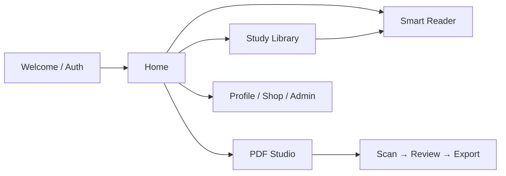

# PHARM D WITH HYZEN

<p align="center">
  
  
  
  
  
</p>

<p align="center">
  <strong>A premium Pharm-D study companion with an offline PDF workspace, smart scanner, academic library, shop and admin tools.</strong>
</p>

<p align="center">
  <a href="https://github.com/Horizon003/pharm-d-with-hyzen/releases/tag/v1.5.0-12">Download APK</a>
  ·
  <a href="https://drive.google.com/file/d/1sBshfLJw-x9QI4D4l1q6E6J2TlvsO4mn/view?usp=drivesdk">Verified Drive package</a>
  ·
  <a href="https://github.com/Horizon003/pharm-d-with-hyzen/pull/2">Current continuation PR</a>
</p>

## Product direction

PHARM D WITH HYZEN is designed around a resource-first academic workflow: students move from their professional year to subjects, topics, notes and PDFs, then use the same app to scan, edit, organize and study their own documents.

The interface uses a slate and deep-teal visual system, a compact navigation shell, responsive cards and clear empty, loading and error states.

## What is included

| Area | Experience |
| --- | --- |
| Academic library | Year-aware subjects, nested study folders, search and PDF-first browsing |
| PDF Studio | Import, merge, reorder, rotate, annotate, render and export documents |
| Precision scanner | Multi-page capture, corner review, enhancement tools and PDF export |
| Smart Reader | Immersive PDF reading with quick actions and grouped tools |
| Offline workspace | Saved, in-progress and failed downloads with local recovery |
| Profile and settings | Academic year, identity, preferences, security and appearance |
| Shop | Products, cart, checkout, orders and admin commerce controls |
| Admin console | Content, students, inbox, products, announcements and Question Bank controls |
| Campus League | **Coming soon** in the free release; no paid billing or live quiz backend required |

## Product map



## Current release

**Android 1.5.0 (build 12)**

- Application ID: `com.hyzen.pharmd`
- Source commit: `b683bd2ba167eac4a9a012c3b0e22e369986f977`
- APK size: 125.4 MB
- APK SHA-256: `077f10865b627993f1b05c3ccf5f74d89db2b210b86ee1b65d2e1e960f45e05e`
- Owner signing certificate SHA-256: `3fd902d131ae56d8de4792c9f5953759e2b375e32bcad8f57f7ef5c0ab887f83`
- Backend: tested locally; not deployed to production
- Campus League: Coming soon and disabled in this release

The release workflow completed:

- 183 Flutter tests
- 87 backend/emulator tests
- 17 Python source and release-evidence tests
- Flutter analyzer with no issues
- Android API 35 emulator installation and launch smoke test
- Original production certificate verification

## Download and verification

Download the APK from the [GitHub release](https://github.com/Horizon003/pharm-d-with-hyzen/releases/download/v1.5.0-12/PharmD-With-Hyzen.apk). The [verified Drive package](https://drive.google.com/file/d/1sBshfLJw-x9QI4D4l1q6E6J2TlvsO4mn/view?usp=drivesdk) contains the APK together with `SHA256SUMS`, signing evidence and release provenance.

Verify the APK checksum after extracting the package:

```bash
sha256sum PharmD-With-Hyzen.apk
# 077f10865b627993f1b05c3ccf5f74d89db2b210b86ee1b65d2e1e960f45e05e
```

## Build from source

The project is assembled from the checked-in phase overlays and the private base source archive. The canonical review assembly keeps source manifests, asset hashes and build mode explicit.

```bash
python3 -m unittest discover -s tools/tests -v
python3 tools/assemble_review.py --repo . --output hyzen_flutter
cd hyzen_flutter
flutter pub get
flutter analyze --no-pub
flutter test --no-pub
```

For a signed build, use **Actions → Build current signed Hyzen APK → Run workflow**. The production keystore is supplied through protected GitHub secrets and is never committed.

## Architecture

- Flutter and Dart for the application UI and state flows
- Riverpod for scoped application state
- GoRouter for authenticated navigation
- Firebase Auth and Firestore for account and academic data
- Android Kotlin bridges for scanner, file picker and PDF operations
- Local storage for offline document workflows and durable recovery
- Node.js Firebase services and emulator tests for private import/play contracts

## Repository guide

| Path | Purpose |
| --- | --- |
| `updates_*.json` | Versioned source and design overlays |
| `tools/assemble_review.py` | Canonical source assembly |
| `tools/release_evidence.py` | APK provenance and certificate checks |
| `.github/workflows/` | Review, security and signed release workflows |
| `quiz-backend/` | Private import, quiz and admin service contracts |
| `firebase-security/` | Firestore and Auth emulator security tests |
| `docs/handoff/` | Current continuation and release notes |

## Product status

The core app and signed 1.5.0 release are available now. Campus League remains a Coming soon surface until a free, secure backend hosting path is selected. Rankings, reward events, membership/pool administration and production quiz deployment are intentionally deferred.

This is a private project for PHARM D WITH HYZEN. Keep signing keys, Firebase credentials, user data and private question banks outside the repository.
